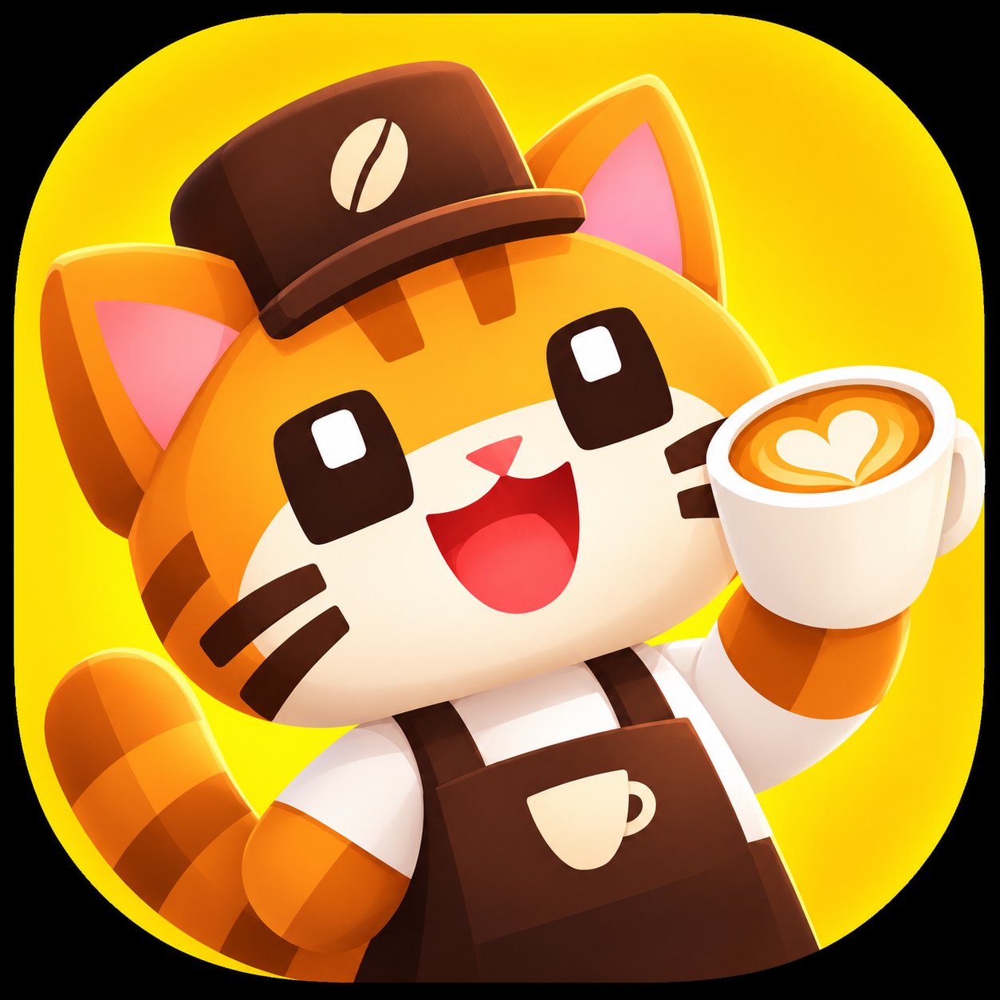

  

<h1 align="center">Merge MVP (Godot 4.4)</h1>

2D merge-игра про кофейню: на поле 4×5 игрок соединяет одинаковые предметы, чтобы
получать улучшенные версии и выполнять заказы. Три цепочки предметов — кофе,
выпечка и цветы; генераторы тратят энергию, заказы приносят монеты, гемы и XP.
Развитие уровня кофейни открывает новые слоты, генераторы и мета-игру: котов,
декор и карту кофейни.

Движок: Godot 4.4, рендерер `gl_compatibility` (Compatibility — `mobile`
