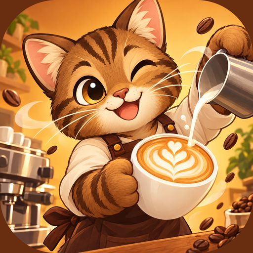

<p align="center">
  
</p>

<h1 align="center">Sweetie Cat's Cafe (Godot 4.4)</h1>

2D merge-игра про кофейню: на поле 4×5 игрок соединяет одинаковые предметы, чтобы
получать улучшенные версии и выполнять заказы. Три цепочки предметов — кофе,
выпечка и цветы; генераторы тратят энергию, заказы приносят монеты, гемы и XP.
Развитие уровня кофейни открывает новые слоты, генераторы и мета-игру: котов,
декор и карту кофейни.

Движок: Godot 4.4, рендерер `gl_compatibility` (Compatibility — `mobile`
рендерер в iOS Simulator нестабилен). Ориентация портретная, референс 1080×1920,
логическое поле 720×1280, stretch `canvas_items` / `expand`.

## Запуск

1. Открыть папку проекта в Godot 4.4.
2. Запустить `scenes/game.tscn` (она же main scene).

Сборка из CLI:

```bash
godot --headless --path . --import
godot --headless --path . --export-release "Android AAB" build/android/SweetieCatsCafe.aab
```

Экспортные пресеты: `iOS`, `Android`, `Android AAB`. Перед релизом заменить
placeholder team id / bundle id и указать пути вывода в `export_presets.cfg`.

## Управление

- Тап по генератору — создать предмет за энергию.
- Drag&drop одинаковых предметов — merge на уровень выше.
- Тап по предмету — продать за монеты.
- Тап по заказу — сдать предметы и получить награду.
- Настройки — бустеры, ежедневные действия, аналитика и сброс прогресса.
- Кнопка «Играть» — карта кофейни: декор, коты, каталог. Мебель покупается за
  монеты в магазине кофейни и попадает в инвентарь — оттуда её ставят на пол.

## Структура

```
scenes/                 game.tscn, item.tscn, ui/ — HUD и попапы
scripts/game.gd         сборка UI, заказы, экономика, реклама/IAP, FTUE
scripts/board.gd        поле, merge, drag&drop, генераторы
scripts/order_manager.gd заказы и награды
scripts/autoload/       Config, SaveManager, Progress, Energy, Analytics,
                        Ads, Iap, Haptics, Meta
scripts/data/           цепочки, арт, изометрия, мета-данные
scripts/ui/             HUD, попапы, карта кофейни
assets/                 арт предметов, UI, иконки
docs/                   GDD, экономика, аналитика, haptics, iOS-тесты
tools/                  нарезка листов, сборка темы UI, иконки приложения
```

Сохранение — `user://save.json` (атомарная запись с `.bak`-резервом).
Запись отложенная: серия действий пишет файл один раз (через 1.5 с), а при
сворачивании, потере фокуса, «назад» на Android и выходе — сразу.
Аналитика PostHog по умолчанию выключена; ключ и consent задаются в
`scripts/autoload/config.gd` / remote config.

## Проверка

Self-test (`scripts/dev/selftest.gd`): merge, сериализация, заказы, прогресс,
бустеры, награды, мета, иконки и изометрия. По умолчанию выключен; включается
только в debug-сборке — настройкой проекта `dev/selftest/enabled = true` или
аргументом `godot -- --selftest`. Тогда лог запуска дублируется в
`user://selftest_result.txt`, а состояние (сейв, поле, заказы) после прогона
откатывается. В release self-test и файловый лог не работают.

## Документация

- `docs/GDD.md` — гейм-дизайн.
- `docs/economy.md` — экономика и цены.
- `docs/analytics.md`, `docs/analytics-events.md` — события.
- `docs/haptics.md` — тактильная отдача.
- `docs/ios-testing.md`, `docs/technspike.md` — платформы и интеграции.
- `docs/ui-icons.md` — арт интерфейса и тема.
